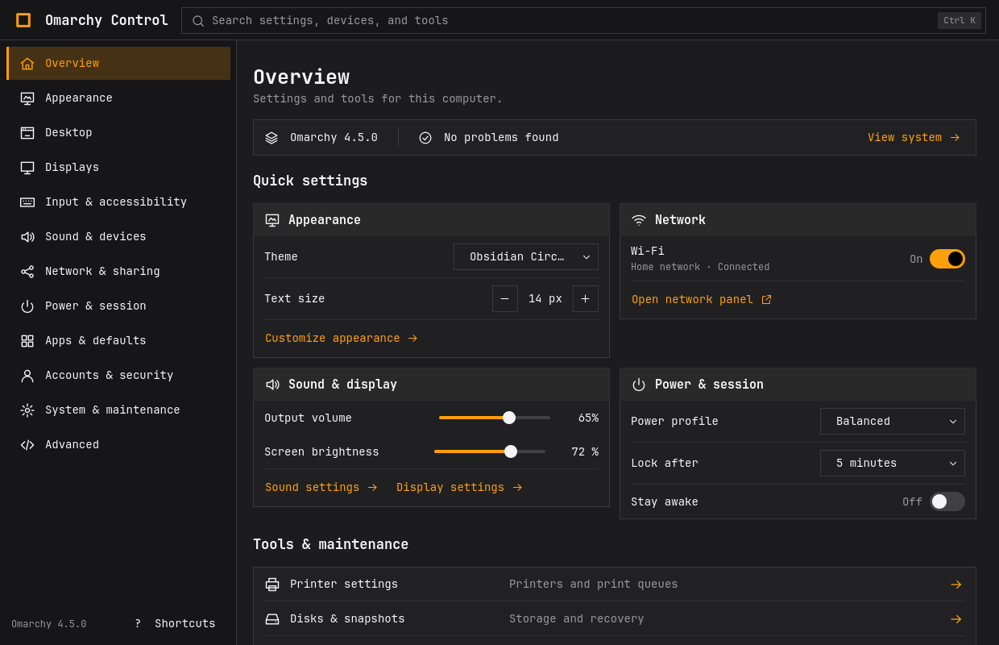

# Omarchy Control



One searchable place to understand this computer, change its settings, and reach the right specialist tool. It follows the active Omarchy theme and language, reuses Omarchy's own commands, and verifies each change by reading the value back.

The screenshot uses a synthetic machine with fictional values.

## Status

Version 0.1.0, built against Omarchy 4.5 and Hyprland 0.56. 50 of 64 writable settings, display recovery, and the real window are verified against real Hyprland, the real shell, and real Omarchy scripts in an isolated nested session. Every setting reads correctly on real hardware. It has not yet changed anything on a real desktop session. [What has and has not been verified](docs/LIVE-CHECKS.md) has the details and a checklist for a first run.

## Install

```sh
bin/install       # Builds the Arch package and installs it (asks for sudo)
omarchy-control open
omarchy-control integrate menu   # Optional: adds it to the Omarchy menu
```

Nothing in your configuration changes on install. The first change to a Hyprland setting asks before adding one marked line to `hyprland.lua`.

## What it does

- **Typed settings** with live values: theme, fonts, text size, windows, bar, dock, idle timers, power profiles, default apps, input, DNS, language.
- **Device pages**: sound routing and volume, Bluetooth, Wi-Fi, display arrangement.
- **Administration**: services, startup apps, storage, plugins, shortcuts, window rules, file associations, typed Superwhisper settings, and guided firewall routes.
- **Every other Omarchy workflow** by name, handing off to the right panel, wizard, app, or config file.

Coverage is [reported by route](docs/COVERAGE.md): 97 native settings and pages, 23 Omarchy panels, 334 guided routes, 15 specialist apps, and 22 config files. Every public Omarchy command and menu row in the 4.5 inventory has a destination or a recorded reason for exclusion.

## How changes stay safe

- Values cross into commands as one argument, never through a shell.
- Every change is journaled and backed up first, or it does not start. It is then applied and verified by reading it back. A failed check restores the previous file, unless someone has edited that file since.
- Undo refuses if anything has edited the value since, and is only offered when the old value can really be set again.
- After a crash, nothing is overwritten. The app reports what happened and where the backup is.
- Hyprland overrides live in one owned file, `~/.config/hypr/omarchy-control.lua`. A hand edit to it is detected and never overwritten.
- Display changes run under a separate watchdog process that restores the previous layout unless you keep the new one. Arranging displays stays locked until `omarchy-control selftest display` has passed on your machine: it moves one display a few pixels, confirms Hyprland took the change, and confirms the watchdog puts it back.
- Wi-Fi switches run under a NetworkManager checkpoint where polkit allows one.
- If Omarchy later changes a command behind a setting, that setting keeps reading but pauses writing until you review it, because each adapter encodes what a specific script does. `omarchy-control compat` shows what changed.
- Package work waits for pacman, and a restore keeps a copy of whatever it replaces.
- Passwords are never collected. Joining a secured network goes to Omarchy's panel.

## Shortcuts

| Key | Action |
| --- | --- |
| Ctrl+K, Ctrl+F | Search |
| Tab, Shift+Tab | Move between controls |
| Space | Activate the focused control |
| Alt+Left | Go back |
| Ctrl+Z | Undo the last change that can be undone |
| Ctrl+Shift+Z | Redo |
| Esc | Close a dialog, this list, or search |
| ? | Show shortcuts |
| Q, Ctrl+Q | Quit |

Single-letter keys switch off while you are typing.

## Command line

Agents and scripts get the same validation and journal as the window. Each command takes `--json` and exits 0 or 1.

```sh
omarchy-control search "stop sleeping"
omarchy-control get power.idle.lock
omarchy-control plan power.idle.lock 600
omarchy-control apply power.idle.lock 600
omarchy-control history
omarchy-control undo <transaction>
omarchy-control doctor
omarchy-control coverage --live
omarchy-control compat
omarchy-control shortcut add "SUPER + ALT + Y" "My tool" my-tool
omarchy-control rule add firefox float
omarchy-control display preview DP-1 1920 0 --keep
omarchy-control launch panel.network
omarchy-control skill install
```

## Development

```sh
bin/build                  # build/omarchy-control
bin/test                   # 244 tests; never touches the real desktop
tools/nested-check.py      # Real Hyprland and Omarchy scripts in an isolated session
tools/package-check.sh     # Install, upgrade, and remove in a disposable pacman root
tools/gen-compat.py        # Re-pin commands after reviewing a changed script
bin/coverage               # Regenerates docs/coverage-ledger.json
tools/i18n-report.py       # Translation coverage per language
```

Tests run in a temporary root with fake commands. `tools/make-sandbox.sh` builds a synthetic machine, and `tools/screens` screenshots the real QML against it.

Project documents: [plan](docs/PLAN.md), [coverage](docs/COVERAGE.md), [P0 findings](docs/P0-FINDINGS.md), [live checks](docs/LIVE-CHECKS.md).

## License

MIT. Theme watching and the translator follow Omacut and Monologue (MIT, David Heinemeier Hansson).
